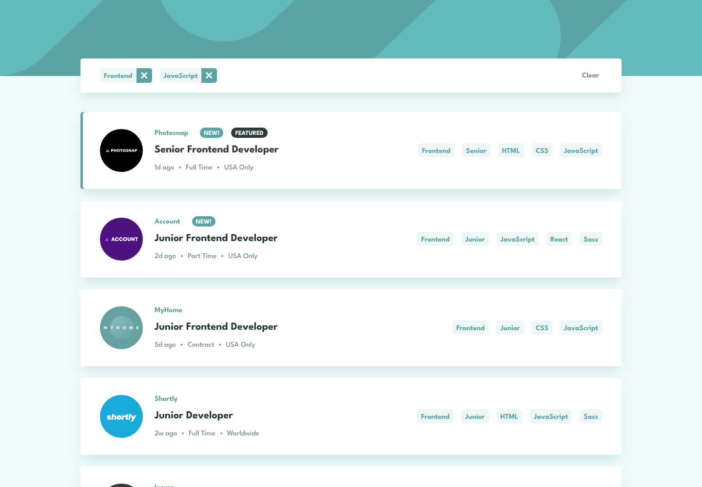

# Frontend Mentor - Job listings with filtering solution

This is a solution to the [Job listings with filtering challenge on Frontend Mentor](https://www.frontendmentor.io/challenges/job-listings-with-filtering-ivstIPCt).

## Table of contents

- [Overview](#overview)
  - [The challenge](#the-challenge)
  - [Screenshot](#screenshot)
  - [Links](#links)
- [My process](#my-process)
  - [Built with](#built-with)
  - [What I learned](#what-i-learned)
  - [AI Collaboration](#ai-collaboration)
- [Author](#author)

## Overview

### The challenge

Users should be able to:

- View the optimal layout for the site depending on their device's screen size
- See hover states for all interactive elements on the page
- Filter job listings based on the categories

I also added:

- Jobs loaded from `data.json` with `fetch`, with a friendly error message if loading fails
- Keyboard focus that stays in a sensible place after every re-render
- A screen reader announcement of the result count ("Showing 2 of 10 jobs")

### Screenshot



### Links

- Solution URL: TODO
- Live Site URL: TODO

## My process

### Built with

- Semantic HTML5 markup
- CSS custom properties
- Flexbox and CSS Grid
- Mobile-first workflow
- Vanilla JavaScript with ES modules (`import` / `export`)

### What I learned

**The filters are the state.** The only thing that changes is which tags the user has selected, so I keep them in a `Set`. A `Set` ignores duplicates on its own, so clicking the same tag twice can't add it twice. Every click only changes the `Set` and calls `render()`.

```js
const filters = new Set();

function render() {
  const visibleJobs = jobs.filter(matchesFilters);
  jobList.innerHTML = visibleJobs.map((job) => jobCard(job, getTags(job))).join("");
  filterList.innerHTML = [...filters].map(filterChip).join("");
  filterBar.hidden = filters.size === 0;
  jobStatus.textContent = `Showing ${visibleJobs.length} of ${jobs.length} jobs`;
}
```

Showing or hiding the filter bar lives in `render()`, not in a click handler, because three different actions (add, remove, clear) can change it.

**Derived data instead of stored data.** Each job's tags come from four fields, and two of them are arrays. Instead of saving a new `tags` field, I build the list when I need it and flatten it into one array:

```js
const getTags = (job) => [job.role, job.level, job.languages, job.tools].flat();
// ["Frontend", "Senior", "HTML", "CSS", "JavaScript"]
```

Without `.flat()`, `languages` stayed a nested array, so three tags ended up in one button and `includes("CSS")` never matched.

**`filter` + `every` + `includes`.** A job stays in the list only if it has every selected tag:

```js
const matchesFilters = (job) =>
  [...filters].every((tag) => getTags(job).includes(tag));
```

When no filters are selected, `every` on an empty array returns `true`, so all jobs show with no extra code. A `Set` has no `map` or `every`, so I spread it into an array first.

**A nested `map` inside a template.** The tag buttons are a `map` inside the job card's template literal, and both levels need `.join("")`. This is the same idea as `{items.map(...)}` in JSX.

**Keeping keyboard focus after a re-render.** `innerHTML` replaces every button, so I save only data before rendering and look the new button up afterwards:

- Clicking a tag on a job: focus goes back to the same tag on the same job (`[data-id] [data-tag]`).
- Removing a filter chip: focus moves to the chip now in the same position, or the last one.
- Removing the last chip, or Clear: focus moves to the first tag of the first job.

```js
const index = [...filters].indexOf(tag); // before delete
filters.delete(tag);
render();
const removeBtns = filterList.querySelectorAll(".chip__remove");
removeBtns[Math.min(index, removeBtns.length - 1)].focus();
```

**Bugs I caught along the way.** I wrote `class="job data-id=${id}"`, so `data-id` became part of the class and `closest("[data-id]")` returned `null`. I also attached the same listener twice while refactoring: `addEventListener` adds a new listener every time instead of replacing the old one.

### AI Collaboration

I use AI as a learning partner to code better, not to skip the learning:

- Used Claude Code to write the HTML and CSS skeleton.
- Used Claude Code to explain the reasoning behind the skeleton's structure.
- Used AI to analyze the product scenario and the key points of the design.
- Wrote the JavaScript myself; used AI to review it, help with the keyboard focus logic for removing filters, and refactor the final file structure.
- Used AI to build a project notebook, where I manually fill in before, during and after notes (design analysis and planned JS flow, every blocker sorted by type, and a final review compared with similar projects) to organize my thinking, summarize the development process, and correct the mistakes I keep making.

## Author

- Website - [Josh Liu](https://my-portfolio-frontend-kappa-lemon.vercel.app/)
- Frontend Mentor - [@JoshLiu111](https://www.frontendmentor.io/profile/JoshLiu111)
